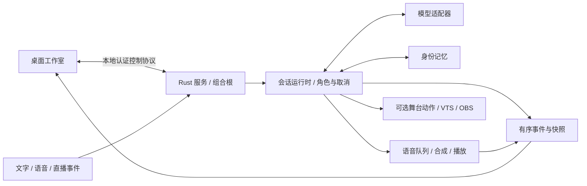

# AIex

一个 Windows 优先、以 Rust 为核心的本地数字伙伴工作室。人格、记忆和表现相互独立：同一个角色可以使用原生人物立绘、自定义图片，也可以隐藏外形或连接 VTube Studio。

最新发布版本：**0.10.0-alpha.1 · 原生窗口操作与记忆迁移**。[版本说明](docs/releases/0.10.0-alpha.1.md)记录交付范围及验证；当前分支正在进行 1.0 开发，尚未完成或发布。[演进路线](docs/DIGITAL_HUMAN_ROADMAP.md)记录后续设计。

**目前还不是整个项目都由 Rust 编写。** 已发布的桌面与服务使用 Rust，本地模型运行方案采用 Rust 和原生组件，使用便携包不需要安装 Python。仓库仍保留旧 Python 源码、测试和工具，供逐项迁移与核对；1.0 的退役工作、无 Python 干净环境及真实设备验收尚未完成。[查看迁移进度与待验收项目](docs/NATIVE_MIGRATION.md)。

**首次体验只需完整解压程序包，双击 `AIex.exe`。** 无需安装 Rust、Python 或 VTube Studio。[整体验收流程](docs/MANUAL_TEST_PLAN.md)从界面操作开始。

[下载 Windows 便携包](https://github.com/QwQBiG/AIex/releases/download/v0.10.0-alpha.1/AIex-Windows-x64-0.10.0-alpha.1.zip) · [查看发布与校验文件](https://github.com/QwQBiG/AIex/releases/tag/v0.10.0-alpha.1)

## 本版新增

- **专用窗口单步操作**：显式扫描和绑定 Windows 窗口，保存手动动作或视觉目标，再在目标前台用快捷键执行。点击、按键、文字、拖动、滚动、等待均经真实许可与持久审计；窗口变化、聊天、暂停和急停撤销旧动作。默认关闭，先用随包的专用画布验收，见[原生操作](docs/NATIVE_DESKTOP.md)。
- **完整来源记忆**：保留导入实体与原始记录的关联，区分本人、第三方和未知主体；更正或遗忘只撤销相应来源贡献。旧平铺文件首写前备份，Chroma 从关闭的快照复制后由固定原生服务导出，见[迁移说明](docs/CHROMA_BRIDGE.md)。
- **可控陪伴体验**：悬浮字幕跟随实际播放；快捷键、主动说话、冷却和免打扰由你显式应用。主动输出不伪造用户消息，不写入用户记忆；支持 VTS 热键发现和脱敏诊断导出。

本版继续使用已固定的 **0.9 CPU 运行组件、模型目录与对应源码**；已有资源无需因应用升级重新下载。真实设备、窗口和私人旧库副本的验收由你按[测试流程](docs/MANUAL_TEST_PLAN.md)触发。

## 在应用内准备本地伙伴

本地模型、声音和人物绑定都在桌面向导中准备。按需要确认下载或导入模型，完成后可以离线使用；首次下载和冷加载需要等待。不需要命令行，也不要求预先安装 Ollama 或 Python。

1. 双击 **`AIex.exe`**，在首页选择 **“准备本地伙伴”**，点击 **“创建本地设置”**。
2. 在 **“1 · 本地对话”** 准备运行组件和对话模型。先看文件大小与 **“许可与来源”**，再点 **“下载准备” → “确认下载”**；已有固定包可填写绝对路径，点 **“从本地导入”**。本地记忆检索可随后准备。
3. 只用文字时保持设备关闭。需要声音时，在 **“2 · 语音开关”** 应用播放开关，在 **“3 · 选择声音”** 准备默认中文声音；需要语音输入再准备识别模型并开启麦克风。
4. 需要专属声音时，展开 **“用参考音频制作专属声音”**，准备其模型，填写清晰 WAV 的路径和录音中实际说出的文字，点 **“导入并保存专属音色”**。原录音保留，服务保存规范化的私人副本。
5. 在 **“4 · 试听与保存”** 选择 **“启用对话声音”** 后，另点 **“播放试听”**；保存开关本身不会播放。可随时停止试听，再点 **“保存声音到当前人物” → “进入聊天”**。

默认麦克风与播放都关闭。播放设置从下一句话起使用，麦克风开关重新进入对话后生效。仅准备文字对话时，可以直接进入聊天；外形预览、OC 素材册与原有外部模型连接仍可独立使用。

开发分支中，离线模型包、目录和参考 WAV 可通过拖放填写路径：在对应项目选择“准备拖入”，将一个文件或目录拖入窗口，核对后点击导入。此功能尚未包含在上面的 0.10 便携包中。

开发分支还支持更正已导入的专属声音：在“选择声音”中选中该声音，点击“修改所选专属声音”，更正名称、录音原文或语言后保存。参考录音和人物绑定保持不变；如果设置已被其他操作修改，草稿会保留供核对。

固定 CPU 路线是托管 Ollama / Qwen3 4B、Sherpa Whisper small INT8、Kokoro v1.1、Qwen3-TTS Base 参考音色及 BGE 中文嵌入。文件准备完成只表示摘要及运行依赖通过校验，首次使用还会加载模型。下载、导入或某项模型加载失败只影响对应能力，设置和人物仍可使用。参考音色的听感需实际试听，不承诺与旧 GPT-SoVITS 权重一致。

原生设置写入独立的 `native-v1.toml`，修改时检查版本并保存备份，不静默覆盖原有个人连接配置。人物和场景分享默认不包含凭据、私人记忆、参考音频及对应原文。具体数据位置和可直接操作的检查见[整体验收流程](docs/MANUAL_TEST_PLAN.md)；本版验证及未测范围见[版本说明](docs/releases/0.10.0-alpha.1.md)。

## 沿用的 0.8 能力与迁移基础

桌面和服务使用 Rust，旧 Python 源码仍保留供逐功能迁移。0.8 已有的下列能力在本版继续保留：

- **记忆工作台**：可选语义召回、角色范围的记忆重建、实体候选与来源核对，以及媒体描述和标签筛选。更正、遗忘会同步更新对应来源，见[记忆工作台](docs/MEMORY_WORKSPACE.md)。实体候选不代表独立事实核验，媒体记录不包含自动理解或原始附件采集。
- **合成模板回放**：服务持有有界图片会话，桌面设置页可开始、暂停、恢复和停止；聊天与语音占用会暂缓回放。可选视觉观察只建议同一目标的搜索区域，增量精确搜索会明确报告预算内未完成的结果。入口和限制见[模板回放说明](docs/TEMPLATE_GAME.md)，当前执行端为合成 dry-run。
- **显式数据迁移**：便携包附带 `ai-ex-migrate.exe`，保留旧备份向量、元数据与显式多模态快照；[Chroma 桥接](docs/CHROMA_BRIDGE.md)保留原始快照并恢复实体来源关联。参数、验证记录与剩余迁移合同集中在[迁移记录](docs/RUST_ONLY_MIGRATION.md)和[工具索引](tools/README.md)。

原生模型与工程工具按[零 Python 路线](docs/NATIVE_MIGRATION.md)分阶段交付。原生窗口的自动测试使用假系统调用与隔离进程，真实专用窗口和设备尚需用户验收。

## 自己的 OC，放在第一位

项目作者的 OC 成为默认的“一号人物”：银灰短发、灰紫眼睛与淡紫领结，支持半身和全身展示。主立绘直接内置在 `AIex.exe` 中，无需下载或导入。原来的“初始伙伴”、自定义 PNG/JPEG 图片角色和隐藏外形仍可选择；换外形不会改动人格或记忆。

离线预览的 OC 素材册可翻看正式立绘、六表情参考，以及欢迎、专注、完成庆祝和温柔鼓励四张动作图。素材册是独立的静态参考，不会替换正在使用的外形。人物选择和构图可随场景保存，并恢复为启动组合；旧场景继续使用原来的初始伙伴。

一号人物使用独立校准的眨眼、说话局部贴层和轻微呼吸；其他情绪以状态文字提示，六表情参考图不会自动切换。这是插画展示，不是 Live2D 或骨骼动画。暖白与淡紫工作区、固定输入区、[记忆工作台](docs/MEMORY_WORKSPACE.md)和角色收藏继续沿用。先按[五分钟外形体验](docs/MANUAL_TEST_PLAN.md)查看效果，再接入自己的模型。

## 可以做什么

| 能力 | 当前实现 |
| --- | --- |
| 自定义角色 | 新建、独立复制、收藏多个版本、导入导出、预览确认后应用 |
| 记忆工作台 | 按角色管理确认笔记、实体来源、媒体描述和标签；更正与遗忘同步更新对应来源 |
| 合成模板回放 | 有界图片清单、聊天与语音暂停、手动恢复和停止；仅记录 dry-run 动作 |
| 原生窗口操作 | 绑定进程身份与窗口几何、真实许可和审计、手动或视觉单步、只释放自有输入 |
| 陪伴与字幕 | 可选悬浮字幕、全局快捷键、主动输出冷却、免打扰、受控设置应用与诊断导出 |
| 多种外形 | 两位内置人物、OC 半身/全身与素材册、PNG/JPEG 表情组、隐藏外形；VTS 可选 |
| 组合场景 | 保存角色、人物选择和构图，图片随包携带；支持启动时恢复已选组合 |
| 本地模型准备 | 应用内确认下载、离线导入、摘要校验、取消和移除；模型缺失时仍可使用外形及设置 |
| 对话与打断 | 托管 Qwen3 4B、本地流式回答；保留原有外部模型连接、有界排队和取消 |
| 声音与表达 | Kokoro 默认声音、参考 WAV 专属音色、试听/停止和人物绑定；字幕与口型跟随实际播放，外部 GPT-SoVITS 继续可选 |
| 故障恢复 | 断线重同步、外形输出降级、停止期间保护已开始的记忆写入 |
| 可选输入与扩展 | 本地 Whisper 识别、原生采集、外部兼容转写、Bilibili、OBS、插件与只读视觉分析 |

网页身体、悬浮人物、VRM 3D、图形化声音/行为包编辑器尚未实现。悬浮字幕独立于人物窗口；场景包目前组合角色与外形，模型凭据、声音配置和私人记忆不随包导出。


使用示例对话进行离屏渲染。人物与聊天并排，舞台装饰色和外形可自行调整。

## 外形与已有外部服务（沿用 0.8 流程）

这部分保留原有外形体验和外部连接；本地模型准备使用上面的向导。

1. 将 `AIex-Windows-x64-0.10.0-alpha.1.zip` 完整解压到可写入的文件夹。
2. 双击其中的 **`AIex.exe`**，点击 **“先体验外形”**。先看一号人物，切换半身/全身，展开 **“OC 素材册”** 翻看原画。无需账号或模型；也可选择初始伙伴或导入自己的图片外形。
3. 直接在预览底部点击 **“开始对话”**，按界面填写模型连接信息并保存。预览中的外形会沿用，后台服务已随包提供，会自动启动。

主窗口分为 **聊天 / 角色与外形 / 场景组合 / 记忆 / 设置与诊断**。输入区支持 Enter 换行，Ctrl+Enter 或“发送”提交；中文输入法确认候选不会直接发送。连接设置中的“启用长期记忆”保存后重启服务生效，关闭不会删除原记录。要修改模型或回到离线预览，在设置页进入“连接设置”或“首页”。

使用这一外部连接入口时，需要自己的云端密钥，或已经运行的 Ollama / KoboldCpp。模型和声音资源没有内置；语音、麦克风、VTS、OBS 默认关闭。云端密钥只在本次进程中使用；未设置对应环境变量时，下次打开会再次进入连接设置。

便携包中 `AIex.exe`、`ai-ex-service.exe`、`AIex.portable` 和 `data` 必须一起保留。配置与记忆保存在 `data`，后台日志在 `data/logs/service.log`。外形偏好和角色收藏仍有本机设置，跨电脑请先导出场景或角色包。详见[便携版使用说明](docs/PORTABLE_WINDOWS.md)。

### 从源码运行或制作程序包

<details>
<summary>开发者构建步骤（使用便携包可跳过）</summary>

以下命令在仓库根目录的 PowerShell 中执行。源码需要 **Rust 1.96 或更新的兼容版本**及对应工具链的 Windows 链接器；首次构建需要下载依赖。

### 1. 通过统一入口构建

```powershell
./tools/dev.ps1 -Workspace core -Task build -Package ai-ex-service,ai-ex-migrate,ai-ex-platform-windows
./tools/dev.ps1 -Workspace desktop -Task build
```

核心与原生工作进程共用根 `target`，桌面固定使用自己的 `target`。统一入口默认 2 个构建任务，检查剩余空间，并拒绝另一个统一入口同时占用相同目录；构建只准备程序，设备是否启用仍由配置控制。

日常先检查改动所在的包，需要时筛选具体测试；完整验证留到交付前执行：

```powershell
./tools/dev.ps1 -Task check -Package ai-ex-core
./tools/dev.ps1 -Task test -Package ai-ex-service -TestFilter native_desktop
./tools/dev.ps1 -Workspace native -Task test -Package ai-ex-native-worker-support
```

已有依赖时可加 `-Offline`，只看执行计划可加 `-Plan`；`-Task verify` 顺序执行格式、测试和严格检查。release 默认关闭增量缓存，日常开发与一次性验证的缓存策略见[维护工具](tools/README.md#构建空间与缓存)。

### 2. 先预览外形

```powershell
& .\crates\ai-ex-desktop\target\debug\ai-ex-desktop.exe --preview
```

此模式无需模型、语音服务或 VTube Studio，可以切换内置外形和手动预览表现。自定义立绘见[图片外形包](docs/APPEARANCE_PACKS.md)。

### 3. 设置并开始对话

```powershell
& .\crates\ai-ex-desktop\target\debug\ai-ex-desktop.exe
```

无参数运行先显示欢迎页，可选择“准备本地伙伴”，或连接已有外部模型服务。外部连接填写模型名称或凭据，勾选“打开 AIex 时自动启动服务”，保存后连接。已有外部配置可用 `--setup` 重新编辑。

日常也可双击 `AIex-Desktop.cmd`；它优先选择 release 程序，其次 debug。**源码验收使用上面的明确路径，避免旧 release 程序遮住刚构建的 debug 版本。** 若程序旁边放有服务二进制，也应同步更新。

- 日常配置：`config/ai-ex.local.toml`；首次设置生成控制令牌，不需要手工填写令牌内容。
- DeepSeek 密钥只在当前设置进程中使用，或从配置指定的环境变量读取，不写入 TOML。重开程序时需重新提供环境变量或通过设置填写。
- 桌面新启动的服务随桌面退出；复用已运行且认证成功的服务时，关闭桌面保留该服务。
- 修改配置后需重启对应服务。相对资源路径按启动工作目录解释，因此从仓库根目录运行。

详细入口、服务模式与诊断见[桌面指南](docs/DESKTOP_USER_GUIDE.md)。独立测试配置与测试端口见[验收流程](docs/MANUAL_TEST_PLAN.md)。

制作同样的便携包（PowerShell 7）：

```powershell
./tools/package_windows.ps1
```

脚本构建 release、检查程序包并在 `dist/` 生成 ZIP 与 SHA256。已有目标会拒绝覆盖；`-Offline` 使用已缓存依赖。仅在已完成对应 release 构建时使用 `-SkipBuild`。0.9 的原生运行组件还需要对应源码、固定 RuntimeManifest 和模型目录，完整顺序以[原生发行工具](xtask/NATIVE_DISTRIBUTION.md)为准；仅构建桌面和服务不会生成这些组件。

</details>

## 按需连接外部能力

| 目标 | 需要准备什么 | 说明 |
| --- | --- | --- |
| 文字对话 | DeepSeek、Ollama 或 KoboldCpp 中任意一种 | 按服务实际支持的模型填写；见[模型后端](docs/MODEL_BACKENDS.md) |
| 语音朗读 | GPT-SoVITS、可访问的参考音频及匹配提示文本 | 启用 `[tts]`；见[声音与表达](docs/SPEECH_PRESENTATION.md) |
| 麦克风对话 | Whisper 兼容 HTTP 转写服务和输入设备 | 启用 `[duplex]`；先验收文字与播放，再测试采集 |
| VTS / OBS | 对应应用及其接口配置 | 原生外形无需它们；VTS/OBS 仍按生成动作调度 |
| 直播输入 | Bilibili 房间及连接配置 | 默认关闭；见[直播连接](docs/BILIBILI_CONNECTOR.md) |

外部模型、语音服务与资源不随项目内置。健康检查会访问配置的外部服务，不是纯离线检查；返回退出码 1 时应查看具体不可用组件。模型不可用时不能完成对话；可选外形不可用时可以降级。

## 整体架构



服务持有会话状态；桌面通过协议提交意图、读取快照并绘制外形。生成进度和实际播放进度分别管理。角色、外形和场景清单共用配置校验，不绑定某个模型或渲染引擎。

完整模块职责、依赖方向、数据流、取消边界及扩展方式见 **[架构说明](docs/ARCHITECTURE.md)**；源码、资源与历史内容的归属见 **[项目目录](docs/PROJECT_LAYOUT.md)**。当前架构检查覆盖主工作区 36 包、独立桌面 1 包和原生工作区 4 包，共 41 包。

## 数据与配置

| 数据 | 归属与保存方式 |
| --- | --- |
| 服务初始配置 | TOML；保存模型引用、初始角色、功能开关和本机路径 |
| 原生模型与声音 | 独立 `native-v1.toml`；模型包、私人声音和临时作业分别保存，不随角色包分享 |
| 角色包 / 外形包 / 场景包 | 角色与外形包为 schema v1；场景兼容 v1，含内置人物选择时使用 v2；详见对应文档 |
| 私人记忆 | 服务配置的 JSONL 文件，按 `profile_id` 逻辑隔离 |
| 收藏 / 外形偏好 / 启动组合 | 本机桌面设置；收藏可跨服务复用，启动组合按配置路径和控制地址区分 |
| 密钥 / 控制令牌 | 环境变量或本机令牌文件，不随组合包导出 |

记忆保存在本机，但召回片段会随对话上下文交给所选模型；使用云模型时，这部分请求会发送到对应服务。角色身份隔离不是文件加密。默认目录中新生成的 Rust JSONL 记忆已排除提交；自定义数据路径需自行确认忽略规则。测试资料请使用验收流程指定的独立目录。

## 验证与文档

[整体验收流程](docs/MANUAL_TEST_PLAN.md)提供简短体验清单，以及可展开的深度检查和故障记录方法。自动验证范围见[本版说明](docs/releases/0.10.0-alpha.1.md)；真实窗口操作和音频设备仍需整机验收。

- [角色收藏](docs/CHARACTER_LIBRARY.md) · [角色包](docs/CHARACTER_PACKS.md) · [图片外形](docs/APPEARANCE_PACKS.md) · [场景组合](docs/SCENE_PACKS.md)
- [记忆工作台](docs/MEMORY_WORKSPACE.md) · [人格与记忆](docs/PERSONA_MEMORY.md) · [控制协议](docs/CONTROL_PROTOCOL.md) · [插件协议](docs/PLUGIN_PROTOCOL.md)
- [开发约定](CONTRIBUTING.md) · [文档索引](docs/README.md) · [后续路线](docs/DIGITAL_HUMAN_ROADMAP.md)

旧 `main.py`、`src/` 和 Python 文档保留为历史行为参考，不属于当前 Rust 启动路径；迁移记录见[技术基线](docs/CORE_TECHNICAL_BASELINE.md)与[退役计划](docs/LEGACY_RETIREMENT.md)。
