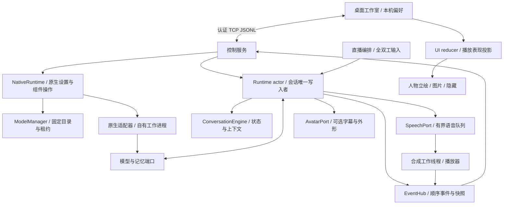
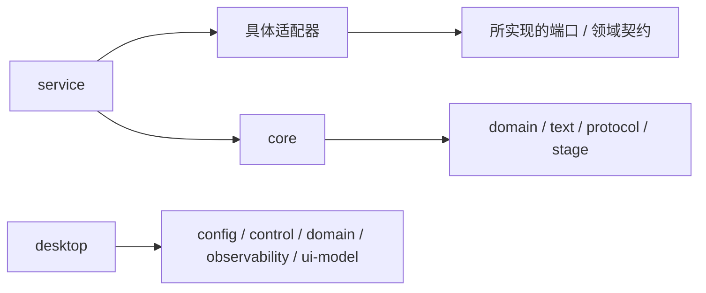

# 当前架构与扩展边界

本文描述当前 0.9.0-alpha.1 开发候选的数字伙伴架构，保留 0.8 的记忆、人物和合成回放，并增加服务持有的原生模型准备与推理。0.9 尚未发布，范围和验证见[待发布说明](releases/0.9.0-alpha.1.md)；已发布基线见[0.8 版本说明](releases/0.8.0-alpha.1.md)。源码和资源归属见[项目目录](PROJECT_LAYOUT.md)，未来设计见[演进路线](DIGITAL_HUMAN_ROADMAP.md)，操作入口见[整体验收流程](MANUAL_TEST_PLAN.md)。

M0 的 Windows CPU 文件链路已通过，产品接入及未测范围单独记录在[原生验证证据](NATIVE_M0_EVIDENCE.md)。0.9 接入不表示 0.10 的真实 Windows 动作、旧记忆完整迁移或 1.0 的 Python 退役已经完成。

## 1. 运行结构与状态归属



这是运行时数据流，箭头不表示 Cargo 依赖。`ai-ex-service` 是组合根，选择模型、装配端口、启动工作线程和控制服务；桌面不实例化模型或音频设备。离线工作室独立运行，只展示本地预览。

便携分发层只负责启动与装配：`AIex.exe` 通过同目录标记选择 `data` 配置，欢迎页可进入离线预览、本地准备或外部连接设置。进入对话后仍由独立服务持有运行时。程序根据自身位置选择工作目录，从快捷方式或其他目录启动也能定位包内配置；显式传入 `--config` 时保留源码模式的路径语义。托管服务日志写入 `data/logs/service.log`，生命周期仍由桌面的管道管理。发行工具只读取明确输入，不扫描个人配置与记忆目录。

桌面内部按职责组织：

| 模块 | 职责 |
| --- | --- |
| `main` / `launch` / `session` / `navigation` | 启动参数校验、页面切换、配置与本次进程凭据、服务和客户端装配 |
| `app` / `app_layout` / `app_chat` | 事件归并、页面布局、输入和消息显示 |
| `app_reflex` | 合成回放的操作草稿、服务确认应答与结果未知提示，不持有执行会话 |
| `native_onboarding` / `native_panel` / `worker_native` | 独立原生启动入口、准备向导、设备草稿和异步控制；只展示服务确认的设置与组件状态 |
| `ui/theme` | 欢迎、设置、预览、聊天和记忆共用的字体与配色，不依赖聊天状态 |
| `ui/test_support` | 仅供测试复用的离屏绘制与输入辅助，不进入发布程序 |
| `worker` | 独立读轮询与命令发送、优先控制、事件补齐与恢复；回放的暂停、停止和查询使用独立有界通道 |
| `memory_panel` / `memory_panel_ui` | 当前角色的记忆列表、笔记草稿、修改确认与异步应答归并 |
| `appearance` / `builtin_character` | 外形偏好、稳定人物 ID、选择与构图，不修改角色身份 |
| `anime_portrait` / `oc_portrait` | 各自的人物素材缓存、局部坐标与绘制；共同消费表现参数 |
| `appearance_import` / `image_appearance` | 自定义图片包的异步校验、解码、纹理选择和失败保留 |
| `welcome` / `preview` / `setup_view` / `oc_gallery` | 首次入口、离线人物舞台、独立静态素材册、连接表单与固定底部操作区 |
| `character_library` / `scene_files` / `scene_resume` | 角色收藏、资源包读写、按连接范围恢复组合 |

服务中的合成回放按下列边界装配：

| 模块 | 职责 |
| --- | --- |
| `template_game` | 显式清单与图片校验、几何映射和独立 CLI 回放 |
| `template_host::TemplateHost` | 持有回放会话、控制代次和仲裁锁；替换或关闭前排空已开始的步骤与审计 |
| `conversation_activity::ConversationActivity` | 登记排队和活动对话的占用，由实际执行任务结算；客户端断开不提前宣称空闲 |
| `strategy_loop` | 可选慢速观察 worker，只产生 Keep / FocusRegion 建议，由宿主在完整快步骤边界核验 |
| `native_runtime` | 原生配置 CAS、模型操作、私人声音绑定、共享托管对话客户端及试听生命周期 |
| `native_ports` | 将本地语音、转写和嵌入接入现有端口；每句话读取当前声音和播放开关 |

快循环通过 `ai-ex-automation::ReflexSession` 执行动作；慢观察不取得输入或暂停恢复权限。当前宿主只构造 `DryRunAutomationPort`，处理清单图片，不接入真实 Windows 捕获和键鼠。聊天、转写和语音占用参与同一暂停仲裁，完整合同与限制见[模板回放](TEMPLATE_GAME.md)。

预览和聊天使用相同应用存储标识，共享外形偏好。页面退出的导航请求本身不启动服务；离线预览不创建模型、网络客户端或声音设备。聊天窗口持有自己启动的子进程并检查它是否提前退出，外部服务只建立控制连接。

PNG 插画通过 `include_bytes!` 编译进桌面程序，解码结果与纹理按生命周期缓存，不在每帧重新读文件。两个人物分别持有校准坐标与渲染状态，切换时清空过渡；OC 的原始主图固定不动，眼睛和嘴部使用独立羽化贴层。静音、停止、断线和减少动态效果优先于说话表现。素材册按需加载六张静态参考，不参与运行时状态投影。

内置人物目录归桌面所有；配置层只校验场景人物 ID 的安全格式，桌面在应用角色前解析是否支持该 ID。旧 v1 场景缺省为初始伙伴，新建桌面偏好缺省为 OC；场景 v2 才记录 OC 人物与构图。自定义图片包与服务控制协议保持原格式，素材与局部坐标不进入核心运行时。

| 状态 | 所有者 | 修改规则 |
| --- | --- | --- |
| 活动回合、短期历史、系统提示 | `ai-ex-core` 的 Runtime / Engine | actor 串行处理；活动回合拒绝切换角色 |
| 长期记忆与当前身份范围 | `ai-ex-memory` | 按 `profile_id` 筛选，记录来源与修改版本；切换等待已开始的存储操作 |
| 语音取消代次、当前播放 | `ai-ex-audio` 与服务播放线程 | 旧代次作废；播放状态由设备进度产生 |
| 事件顺序与快照 | `ai-ex-observability` | 串行分配序号、更新快照并广播 |
| 服务人格快照与命令应答 | 服务控制后端 | 对应命令成功后确认；不由桌面草稿推断成功 |
| 编辑草稿、收藏、外形、启动组合 | `ai-ex-desktop` | 草稿与已应用内容分离；资源校验和服务确认后切换 |
| 合成回放会话与控制租约 | 服务 `TemplateHost` 与 `ai-ex-automation::ReflexSession` | 宿主仲裁操作与占用；旧代次不能恢复执行，慢观察结果在下一完整步骤边界核验 |
| 模型文件与准备操作 | `ai-ex-model-manager` | 只接受固定目录中的 ID，完整校验与原子提交后才暴露就绪；活动租约阻止移除 |
| 原生设置、声音及进程 | 服务 `NativeRuntime` 与适配器 | 版本检查和备份后生效；只管理本应用启动的进程，桌面不持有数据库、设备或模型句柄 |

## 2. 模块地图

当前主工作区包含 36 个包（含 `xtask`）；桌面使用独立清单和锁文件，`native-workers` 独立工作区包含 4 包。三个清单的 `cargo metadata --no-deps --locked --offline` 合计 41 包，原生进程通过协议接入服务。

| 职责 | 实际包 | 主要边界 |
| --- | --- | --- |
| 类型与契约 | `ai-ex-domain`、`ai-ex-protocol` | 领域类型无 I/O；通用协议封装依赖领域类型 |
| 配置与资源清单 | `ai-ex-config` | TOML、角色/外形/场景校验；桌面负责图片解码和绘制 |
| 对话编排 | `ai-ex-core`、`ai-ex-text` | 状态机、端口、取消与分句；不依赖具体网络/设备实现 |
| 模型 | `ai-ex-deepseek`、`ai-ex-ollama`、`ai-ex-koboldcpp` | 实现模型端口，处理流协议和取消 |
| 记忆 | `ai-ex-memory` | JSONL、身份隔离、词法/可选语义召回、实体与媒体来源、带版本检查的管理及显式维护 |
| 表现与声音 | `ai-ex-stage`、`ai-ex-vts`、`ai-ex-stage-obs`、`ai-ex-audio`、`ai-ex-tts` | 舞台能力路由、可选外形、语音队列、合成及播放 |
| 语音输入 | `ai-ex-duplex`、`ai-ex-asr`、`ai-ex-capture` | VAD/输入契约、HTTP 转写、可选原生采集 |
| 直播与回放 | `ai-ex-event-bus`、`ai-ex-bilibili`、`ai-ex-simulator` | 直播领域事件、连接与离线模拟；与运行状态事件区分 |
| 扩展与动作 | `ai-ex-plugin`、`ai-ex-vision`、`ai-ex-safety`、`ai-ex-automation`、`ai-ex-audit` | 插件协议、只读观察、能力许可、受控反射会话和审计；当前回放使用合成端口 |
| 观察与控制 | `ai-ex-observability`、`ai-ex-control`、`ai-ex-ui-model` | 运行状态事件、认证控制协议、框架无关的 UI 投影 |
| 入口 | `ai-ex-service`、`ai-ex-migrate`、`ai-ex-desktop` | 服务装配、旧配置迁移、独立桌面 |
| 原生组件 | `ai-ex-model-catalog`、`ai-ex-model-manager`、`ai-ex-inference`、`ai-ex-native-models` | 固定模型/运行库清单、下载导入事务、租约、受控 stdio、进程与请求生命周期 |
| Windows 平台 | `ai-ex-platform-windows` | 自有 Job 进程树、监听端口身份与平台 FFI；不发送真实键鼠 |
| 工程入口 | `xtask` | 文件/进程探针、固定分发与对应源码归档；不代替设备验收 |
| 原生进程 | `ai-ex-native-worker-support`、`ai-ex-native-bge-worker`、`ai-ex-native-sherpa-worker`、`ai-ex-native-qwen-worker` | 独立原生依赖与进程，不向桌面暴露模型句柄 |

源码入口：[运行时](../crates/ai-ex-core/src/runtime.rs)、[端口](../crates/ai-ex-core/src/ports.rs)、[服务装配](../crates/ai-ex-service/src/main.rs)、[桌面入口](../crates/ai-ex-desktop/src/main.rs)。仓库没有统一名为 `ai-ex-adapters` 的包。

## 3. 依赖方向与执行检查

以下箭头表示“左侧包依赖右侧包”：



网络、音频设备、窗口和具体后端不进入领域层。适配器按自身需要依赖契约，不要求全部依赖 core。桌面允许复用配置、客户端和投影类型，但不能直接依赖 core、service 或具体适配器。

[架构检查脚本](../tools/check_architecture.ps1)读取主工作区、桌面和原生进程三个 Cargo 清单的真实元数据，与逐包允许列表比较。所有本地路径依赖都必须对应已登记的包名和实际 Cargo 清单路径；同名包指向其他目录或注册表依赖也会被拒绝。检查器还扫描 `crates/` 和 `native-workers/` 直接子目录，拒绝未登记的 Cargo 包，不递归扫描构建目录或嵌套测试资料。脚本路径相对于自身位置解析，可从其他工作目录执行。

```powershell
pwsh -NoProfile -File tools/check_architecture.ps1
pwsh -NoProfile -File tools/check_architecture.ps1 -ProbeViolation
pwsh -NoProfile -File tools/test_architecture.ps1
```

第一条应成功并报告 41 个包；第二条在内存中的元数据注入领域层/桌面反向依赖，**应退出 1**。第三条执行检查器自身的正反例回归，**应退出 0**；回归使用隔离测试目录和元数据，不修改真实 Cargo 清单。该检查约束包登记、路径和内部依赖方向，不检查第三方依赖是否含 I/O，也不能替代运行时测试、代码评审或进程隔离。

### 原生模型准备与推理

依赖保持“桌面 → 控制协议 → 服务 → 适配器”。`ai-ex-model-manager` 只依赖领域与固定清单，不反向依赖服务或 UI；`ai-ex-native-models` 实现语音、转写和嵌入端口，服务装配它们与共享的托管 Ollama 客户端。自有业务、GUI、原生工作进程禁止 unsafe；Windows 平台 FFI 集中在 `ai-ex-platform-windows`，原生库的第三方内部实现不由 GUI 承担。

`NativeRuntime::start` 只创建控制与后台校验任务。坏配置、缺模型、加载失败保留在对应状态中，不令整个服务退出；控制界面、错误查询、人物预览和其他可用能力继续工作。首次向导使用独立 `native-bootstrap.toml` 和 `native-v1.toml`，原有外部连接配置保留。配置更新核对预期 revision，先备份原字节，再写新版本；存储目录变更需排空任务、关闭适配器并后台重开管理器。麦克风开关重新进入对话生效，播放和人物声音在后续语句读取。

固定 `DistributionCatalog` 将模型与运行包分开声明。只有已知 ID 可下载或导入；HTTPS 输入固定版本、大小和 SHA256，离线导入不信任替代清单，也不执行包内代码。每次操作用唯一 staging，流式复制并校验全量文件，拒绝 ZIP 路径穿越、大小写重复、未声明文件与重解析点。校验后原子提交，失败/取消不破坏当前安装；已校验模型可先保存，等待匹配运行包时保持未准备。安装路径是 `<packages>/{models,runtimes}/<id>/<revision>/{manifest.json,data/}`，模型文件位于 `data`，元数据位于外层。

管理器拥有准备任务和 OS 目录锁；控制调用短应答返回操作 UUID，界面随后查询进度。就绪表示文件与固定运行依赖兼容，模型冷加载另有 worker 状态。重启先核验运行包再核验模型；SHA 每 64 KiB 检查取消，退出先发取消再等待任务收束和目录锁释放。租约覆盖模型及其依赖运行包，直到进程真正回收才释放；移除需先卸载相关 worker 或清理自有 Ollama 私有链接。仅卸载某项能力不会永久关闭共享 pool。

Sherpa、Qwen 和 BGE 按后端隔离 worker 与 DLL 目录；模型大文件由租约声明的公共 packages 根读取，不复制到每个请求目录。控制通过受限 stdio，音频只传私有作业文件引用。请求携带会话、请求 ID、代次及模型引用；取消只匹配该身份。尚未提交的请求不再开始；活动计算先协作取消，必要时等待至多一秒后终止并回收对应工作进程，完成回收才确认取消。旧请求不重放，旧清理不能卸载或杀死新请求。

本地对话通过独立 Ollama 原生实例和私有 loopback 地址运行；固定 GGUF 与四个控制文件由同一清单校验，使用非思考预设。Windows Job 持有本应用启动的进程树，核对监听端口属于该树。服务不会停止用户自行运行的 Ollama，也不使用它的私人模型目录。

试听复用 `SpeechQueue`、`SpeechActivity`、`AudioPlayer` 与 `EventHub`，不另建播放器。默认播放关闭；保存开关后仍需单独点击试听。试听持有自己的代次与活动 guard，直到合成取消/回收和实际播放结束。`SpeechPreviewStarted` 只更新声音投影，不增加聊天轮次；事件在 EventHub 的有序锁内核对当前代次。停止只撤销自己的代次，带原 turn/sentence 的 inactive 事件不能清掉较新的嘴型或字幕。关闭服务释放试听上下文里的队列 sender，避免阻塞播放线程退出。

完整的固定输入与源码归档流程见[原生发行工具](../xtask/NATIVE_DISTRIBUTION.md)。运行包的对应源码归档作为已声明字节保存，不递归展开或执行；配置、私人声音、凭据和记忆不进入公开分发材料。

## 4. 一轮对话的完整流转

1. 桌面发送带令牌的命令；服务校验输入并等待 Runtime 确认可执行或已排入有界队列，再返回接受应答。队列满会直接拒绝；接受命令不代表模型已完成回答。
2. Runtime 创建回合 ID，取消旧语音，检索当前角色的记忆，再构建模型上下文。
3. 模型流经情绪前缀解析和分句；文本事件发布到快照，语句进入有界语音队列。
4. 播放线程合成并播放，报告语句 ID、情绪和播放进度。桌面从实际播放状态绘制字幕与口型。
5. 生成完成后提交完整回答到记忆。生成结束与声音播放结束是两个独立时刻。
6. 打断取消未完成生成和旧语音代次，回滚未完成回合的短期历史；已开始的持久写入会继续完成。

模型、召回、排队与末尾分句等待都处于可取消范围。核心的单次端口取消及外形调用采用 250 毫秒异步等待上限；原生适配器另外持有请求和租约，后台实际回收遵守上文的 worker 合同，不能把核心等待超时视为进程已经退出。语音先停，外形后清理；失败产生诊断事件。同步阻塞适配器、事件发布和存储写入不受同一上限统一约束。

StageRouter 依据 `Speech` 能力分组清理；外形扩展应与语音执行器分开。VTS/OBS 尚未接入原生播放时间线，仍消费生成时的舞台动作。详见[声音与表达](SPEECH_PRESENTATION.md)。

桌面不能仅用快照序号推进聊天游标：快照不携带正文。周期刷新先补拉事件到目标序号；若事件已经更新到更晚的位置，丢弃旧快照。事件服务的 `instance_id` 区分不同运行实例，避免新实例序号追平时误认旧历史。短断线沿用游标补齐，缓冲区缺口或实例变化则明确提示历史不完整，保留已显示文字并结束旧流状态。普通命令排队与合并后的打断/急停分别调度，关闭桌面取消网络等待；结果未知的请求不自动重发。

`PresentationAnimator` 位于 `ai-ex-ui-model`，每个外形实例保存自己的瞬时表现状态。动画参数与具体绘制分离：默认插画取局部表情状态帧并做细微呼吸，自定义图片包选择清单中的离散图片；保留的几何绘制工具可消费连续五官参数。静音、失同步、断线、打断和减少动态不保留说话帧，不延长旧音节。该历史不落盘，不生成主动行为，也不修改用户图片资源。

## 5. 角色、包与数据边界

- **身份**：`profile_id` 决定记忆归属；名称、外形和场景 ID 不代替身份 ID。
- **设定版本**：`revision` 标识设定版本。收藏检查同身份/版本冲突；服务尚无基于旧版本的并发编辑事务。
- **角色包**：独立设定快照；模型和设备由运行配置提供。
- **外形包**：包内图片和状态映射；不持有会话逻辑，不执行包内代码。
- **场景包**：当前已应用的角色、外形和偏好组合；图片随包复制，私人记忆和服务凭据不导出。
- **启动组合**：桌面本机快照，按配置绝对路径与控制地址区分；复用已有服务时先预览确认。
- **私人声音绑定**：`native-v1.toml` 以 `profile_id` 绑定声音 ID；参考 WAV 的规范化副本与原文属于私人设置，不随人物或场景导出。

导入先校验版本、资源路径、大小和图片内容，再进入确认流程。连接超时可能导致客户端无法确定服务是否已应用，此时保留本地外形并提示重新确认；没有跨进程事务回滚。持久记忆存在本机，召回内容会随请求发送到用户选择的模型。

### 记忆存储与检索职责

| `ai-ex-memory` 内部模块 | 职责 |
| --- | --- |
| `record` / `writer` | JSONL 记录、派生检索字段、文件读取和独占写入租约 |
| `retrieval` / `policy` | 默认混合召回或显式旧兼容策略、模型空间核对与显式向量重建；评分公式不触发后台维护 |
| `entities` / `knowledge` | 从记录建立有来源的实体候选，提供媒体描述、标签与结构化特征查询 |
| `management` / `maintenance` | 确认笔记、更正、遗忘与显式媒体维护，持久写入成功后才发布修改 |

向量模型通过 `EmbeddingPort` 注入；没有配置时保持本地检索。旧备份、媒体快照与显式 Chroma v2 快照由 `ai-ex-migrate` 转换，桌面不直接连接旧数据库。实体候选不等于已核实事实，媒体元数据也不等于自动理解或原始附件迁移；格式、导入范围与原生库验收限制见[Rust 迁移记录](RUST_ONLY_MIGRATION.md)。

### 记忆管理的数据流

桌面通过控制协议提交 `MemoryRequest`，Runtime actor 负责与回合、角色切换和停止请求协调，再通过 `MemoryPort::manage` 调用存储；桌面不直接读取或改写 JSONL。活动回合期间拒绝管理，桌面还会等实际播放结束。列表只读；新建、更正、遗忘完成持久写入后，再清空当前短期上下文并停止旧表现。桌面以成功应答为准清空聊天显示，保留聊天输入草稿。

应答 `MemoryReply` 同时返回结果与执行后的运行快照。确认修改成功时，桌面检查服务实例并把快照序号作为已清理对话的边界，拒绝迟到旧事件重建聊天；不会用较早快照倒退当前序号。列表应答中的快照不推进聊天游标，避免跳过尚未收到的正文。协议结构与分页预算见[控制协议](CONTROL_PROTOCOL.md)。

所有请求校验 `profile_id`；更正和遗忘同时校验记录 ID 与 `expected_revision`，防止旧页面覆盖较新的记录。记录的 `revision` 与角色设定版本彼此独立。持久修改先写入并同步同目录唯一临时文件，再替换原文件；失败时不把内存列表提前改成成功状态。该边界针对单个服务进程，不提供多个独立进程共同编辑文件的事务保证。

记录来源分为自动记录、用户笔记和用户更正。确认笔记优先参与当前角色召回，仍受总条数限制；自动记录按相关性选择，不视为已确认事实。列表独立支持关键词、分类和分页；超长单条通过 `truncated_ids` 明确表示只传输了片段，查看不会截断原始文件。

桌面为每次操作分配请求 ID，切换角色后丢弃不再匹配的旧应答；笔记草稿按角色暂存。写入结果未知时保留草稿并要求先刷新核对，禁止自动重发。单条删除不会查找其他记录或角色设定中的同义信息，完整历史恢复与概念级遗忘仍未实现。面向用户的完整边界见[记忆工作台](MEMORY_WORKSPACE.md)。

## 6. 生命周期与后续扩展

桌面启动的 `--managed` 服务由专用管道维持，关闭桌面请求退出；桌面最长等待 8 秒，超时只终止自己持有的服务进程。`--serve` 可独立运行，复用它的桌面关闭时不终止它。配置修改在服务重启后生效。

扩展时优先沿用现有契约：模型实现 `LanguageModelPort`，存储实现 `MemoryPort`，舞台实现 `StageExecutor`，新输入向运行时提交意图。网页/3D 应消费版本化表现协议，不复制会话核心；目前尚无浏览器桥接，不应把当前 TCP 端口当作浏览器接口。

后续重点仍是跨载体播放同步、声音/行为组合、连续关系记忆和更完整的恢复机制。当前版本不为这些概念增加空模块；先按验收流程验证现有链路，再根据实际失败场景调整职责。
